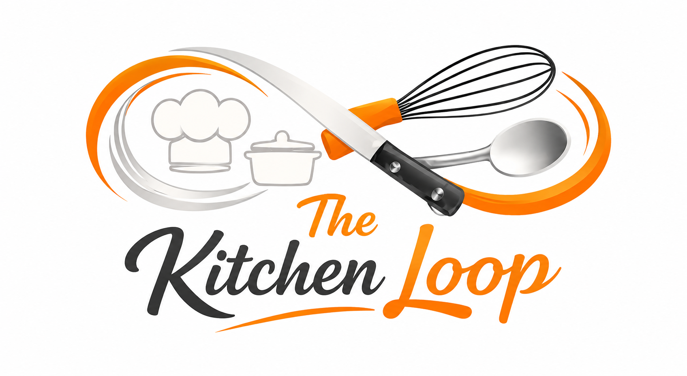

<p align="center">
  
</p>

# The Kitchen Loop — Community Edition

A self-hosted recipe book, fortnightly meal planner and shopping-list generator for one household. It runs on your own computer, keeps your data in a single local file, and needs no accounts, cloud services or API keys.

**Version 0.1.0** · MIT licence

## Features

- Recipe library with search, categories and links to the original video or post
- Add, edit and delete recipes; log when you cook them
- One-click fortnightly plan: 14 different dinners, a lunch rotation and a dessert each week, with suggested sides
- Shopping list built from the plan (or from a hand-picked custom list), split into big shop, fresh top-ups and staples to check, with tick-off, print and copy/share
- Cooking history, activity heatmap and stats
- Starts with 18 recipes: 15 originals from The Kitchen Loop and 3 invented samples — edit or delete any of them

## Recipes from The Kitchen Loop

A new installation includes 15 recipes published by The Kitchen Loop (Andrea Costa), marked with a small logo and the label “The Kitchen Loop Original”.

- **The cooking method for these recipes lives in the original social posts, by design.** The app keeps each recipe's name, categories and ingredients — enough to plan meals and build shopping lists — and its recipe card has a **View cooking method** button that opens the original post on TikTok, with Instagram and Threads buttons alongside.
- **Viewing a method needs an internet connection.** Posts open in a new browser tab, outside the app. Everything else works offline.
- The 3 invented sample recipes have no social posts and include full written methods.
- The “Original” marker is kept when you edit an original recipe and when you restore a backup. It is only recognised on the 15 recipes that ship with the app (by their fixed ids), so it cannot be added to your own recipes — not through the app, and not through an edited backup or data file. The marker means “this started as a Kitchen Loop original”, not that its current contents are unchanged: you can edit an original recipe in the app and it keeps its marker.
- **The badge is protected during normal use of the app, but it is not tamper-proof.** Your data is a plain file on your own computer. Someone who edits that file (or a backup) by hand can put any content under one of the 15 original recipe ids, and it will keep the badge. The badge is a convenience label, not a guarantee of authenticity — the authentic versions of these recipes are the original posts on TikTok, Instagram and Threads.
- The starting recipes are only added to a brand-new installation. Upgrading never changes or replaces your existing recipes, and new posts by The Kitchen Loop are not added automatically.

## Quick start (Docker)

You need [Docker](https://docs.docker.com/get-docker/) with Docker Compose v2 (included in Docker Desktop) and Git.

```bash
git clone https://github.com/costa911/kitchen-loop-community.git && cd kitchen-loop-community && docker compose up -d
```

Then open **http://localhost:8080**.

The first start builds the image (about a minute) and creates your data with the sample recipes. There is nothing to configure.

| Task | Command |
|---|---|
| Stop | `docker compose stop` |
| Start again | `docker compose start` |
| View logs | `docker compose logs -f` |
| Upgrade to a newer version | `git pull && docker compose up -d --build` |
| Use a different port (e.g. 9090) | `KITCHEN_LOOP_PORT=9090 docker compose up -d` |
| Remove the app, **keep** your data | `docker compose down` |
| Remove the app **and delete all your data** | `docker compose down -v` |

Your data lives in a Docker volume (`kitchen-loop_kitchen-loop-community-data`). It survives restarts, upgrades, rebuilds and `docker compose down`; only `down -v` deletes it.

### Podman

The same compose file works with Podman (tested with rootless Podman 5.8 and podman-compose 1.6):

```bash
podman compose up -d        # or: podman-compose up -d
```

In the commands in this README, replace `docker compose` with `podman compose` or `podman-compose`.

## Running without containers (Node.js)

You need [Node.js](https://nodejs.org/) **22 or newer**. There are no dependencies to install.

```bash
git clone https://github.com/costa911/kitchen-loop-community.git && cd kitchen-loop-community && node server.js
```

Open **http://localhost:8080**. Data is stored in `./data/kitchen-loop.json`. Stop with `Ctrl+C`.

Optional settings (environment variables): `PORT` (default `8080`) and `DATA_DIR` (default `./data`).

**One server per data directory.** Run only one copy of the app against a given data directory (or Docker volume). Two copies would each keep their own in-memory copy and overwrite each other's changes, so the app enforces this: a second server, or a `restore`, using the same data refuses to start and says so. The lock is held by the operating system for as long as the app's process exists — even while it is paused or the computer is asleep — and is released the moment the process ends, including after a crash or power cut, so there is never anything to clean up or wait for. Do not delete the `.kitchen-loop-*.lock` file in the data directory while the app is running. To run two independent households, give each its own `DATA_DIR` and `PORT`. The lock is designed for local disks and Docker/Podman volumes on one computer, not network filesystems.

Running directly with Node.js is supported on Linux and macOS. On Windows, use Docker Desktop or WSL2.

## Backup and restore

A backup is a single JSON file containing all your recipes, plans, history and shopping ticks. Take one before upgrading, and keep copies somewhere other than this computer.

**Docker / Podman**

```bash
# Back up (the app can keep running)
docker compose exec -T kitchen-loop node server.js backup > kitchen-loop-backup.json

# Restore (replaces ALL current data with the backup)
docker compose stop
docker compose run --rm -T kitchen-loop node server.js restore < kitchen-loop-backup.json
docker compose start
```

**Node.js**

```bash
node server.js backup > kitchen-loop-backup.json          # back up
# stop the server first (Ctrl+C), then:
node server.js restore < kitchen-loop-backup.json         # restore
node server.js                                            # start again
```

Restore always validates the backup completely before touching anything. A damaged or wrong file is refused and nothing is changed. If the current data was valid, it is kept as `kitchen-loop.json.bak`. If it was damaged, it is kept aside as `kitchen-loop.json.damaged-<date>` and the existing `kitchen-loop.json.bak` is left untouched, so a damaged file can never replace your last good backup. Restore refuses to run while the app is using the same data, so stop the app first. Any browser tab that was open will ask you to reload.

### If the app will not start

If the data file has been damaged (for example by editing it by hand), the app refuses to start rather than risk overwriting it, and says why. Every save keeps the previous valid version as `kitchen-loop.json.bak`, so you can recover with a restore:

```bash
# Docker / Podman: restore the automatic previous version
docker compose stop
docker compose run --rm -T kitchen-loop sh -c 'node server.js restore < /data/kitchen-loop.json.bak'
docker compose start

# Node.js
node server.js restore < data/kitchen-loop.json.bak
```

…or restore from your own backup file, as above.

If the data file is missing but `kitchen-loop.json.bak` is still there, the app also refuses to start instead of quietly beginning again with the sample recipes. Restore the backup as above, or move it aside if you really want a fresh start.

## Security and privacy

- **Local only.** The app is published on `127.0.0.1` only, so other devices on your network and the internet cannot reach it. As a second layer, it refuses any request that is not addressed to `localhost`, which also blocks DNS-rebinding attacks from websites you visit.
- **No login, by design.** Anyone who can use your computer account can use the app. Exposing it to a network or the internet is not supported in v0.1, because it has no authentication.
- **Protected changes.** Changes must be JSON requests from the app's own page. Cross-site requests are refused, and there are no CORS headers. Every request is validated, and all recipe text is escaped before it is shown. Only `http(s)` links can be clicked.
- **One process per data directory**, enforced by a lock file (see above).
- **Safe saving.** Writes are atomic: the app writes a new file and swaps it in, so a crash cannot leave a half-written file. Writes are applied one at a time. A save made from data that is out of date (for example from a second open tab) is refused instead of silently overwriting newer changes.
- **No outside connections by default.** The app sends no analytics, tracking or calls to outside services unless the user explicitly enables one or more anonymous metric permissions from the Privacy view. The font is bundled.
- **Optional anonymous metrics with separate consent.** Adoption metrics send one install event and at most one heartbeat per month. Product-usage metrics require a separate, versioned consent and count only successful recipe creations, successful recipe edits and activated recipe social/cooking-method links. Approximate country-level reach requires a further renewed consent; existing installations are not assigned a country until that consent and a later event. The payload contains only a random installation identifier, app version, broad platform family, one allowlisted event type and a consent marker. Recipes, recipe identifiers, ingredients, names, URLs, plans, shopping lists, email addresses, IP addresses, GPS data, coordinates, cities, file paths and browsing history are never sent. The Community Edition contains only the optional client-side consent and event sending; its separately operated telemetry backend, storage and private dashboard are not part of this repository. Existing adoption opt-ins do not enable usage or country metrics.
- **Hardened container.** The container runs as an unprivileged user with a read-only filesystem and all Linux capabilities dropped.

## Development and tests

```bash
npm test                                   # unit + API tests (Node built-in test runner, no installs)
COMPOSE="docker compose" scripts/smoke-compose.sh   # container test: build, binding, restart, backup/restore
```

The browser end-to-end test is optional and needs Playwright plus a Chromium binary:

```bash
npm install --no-save playwright-core
CHROMIUM_PATH=/path/to/chrome node scripts/e2e-browser.mjs
```

What has and has not been tested so far is recorded in [TESTING.md](TESTING.md).

Project layout: `server.js` (entry point and backup/restore commands), `lib/` (HTTP app, storage, validation), `public/` (the single-page frontend), `seed/` (sample recipes), `test/`, `scripts/`.

## Licence and attribution

MIT — see [LICENSE](LICENSE). The frontend is adapted from the original The Kitchen Loop by Costa (MIT). The DM Sans font is bundled under the SIL Open Font License 1.1 (`public/fonts/OFL.txt`).
